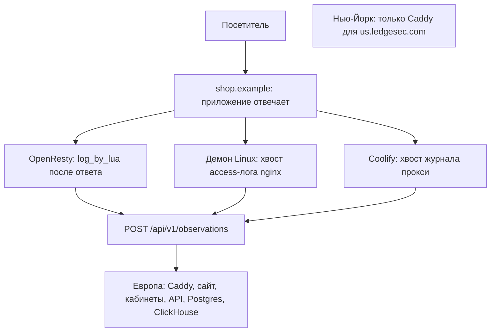

# Ledgesec

Журнал запросов веб-сервера. Демон читает access-лог nginx или прокси Coolify и запрос не меняет. Кабинет показывает путь, код ответа, время и зонд. Адрес посетителя видит администратор. Пользователь сайта видит запросы своих хостов без адресов.

Это не WAF. Запрос идёт в приложение как раньше. Лицензия — MIT.

Монорепозиторий. Край, кабинет и API живут здесь. Пакет на сервер заказчика тоже здесь, отдельным каталогом. Номер продукта — файл `VERSION`: закрытая работа поднимает patch и получает тег. Minor и major ставит человек вручную.

| Каталог | Что это |
| --- | --- |
| `edge/` | Caddy нашего края. Первая поставка: два сервера, порт 443 только здесь. |
| `api/` | Учёт сайтов, сертификаты, снимок, чтение журнала. На путь посетителя не встаёт. |
| `web/` | Сайт, блог и два кабинета. Сайт бумажный, кабинеты — оболочка Threatrix. |
| `packages/customer-gate/` | Lua на OpenResty заказчика. Без пропуска отправляет браузер на край. Для тех, кто не меняет A. В кабинет v1 не входит. |

Angie и Caddy появятся своими пакетами, когда до них дойдёт заказчик. Пока их нет.

## Схема

Посетитель приходит на сервер заказчика. Приложение отвечает как раньше. Сборщик только читает журнал и шлёт пачку `POST https://dash.ledgesec.com/api/v1/observations`. Европа хранит журнал. Нью-Йорк — отдельный край, баз и кабинета там нет.



Нью-Йорк на путь запроса заказчика не встаёт и журнал не хранит.

## Подключения

Секрет приёма и идентификатор хоста кабинет показывает у хоста. В примерах ниже стоят заглушки. Файл один: `/etc/ledgesec/agent.env`.

```
LEDGESEC_SITE_ID=host-from-the-cabinet
LEDGESEC_INGEST_SECRET=from-the-cabinet
LEDGESEC_INGEST_URL=https://dash.ledgesec.com/api/v1/observations
```

### OpenResty

`log_by_lua` пишет строку после ответа. Запрос не меняется. Обычный nginx этот файл не загрузит: там демон Linux.

```nginx
env LEDGESEC_INGEST_SECRET;
env LEDGESEC_SITE_ID;

http {
    lua_package_path "/usr/local/ledgesec/lua/?.lua;;";
    lua_shared_dict ledgesec_observe 16m;

    init_worker_by_lua_block {
        require("ledgesec.observe").start()
    }

    server {
        listen 443 ssl;
        server_name shop.example;

        location / {
            log_by_lua_block {
                require("ledgesec.observe").note()
            }
            proxy_pass http://app:8080;
        }
    }
}
```

### Демон Linux

Nginx остаётся своим. Формат стоит в блоке `http`, чтобы попал каждый сервер этой машины. Если у `server` уже есть свой `access_log`, строку `ledgesec` повторяют там. `ledgesec-agent` читает файл и шлёт ту же пачку.

```nginx
log_format ledgesec '$msec $remote_addr $host "$request" $status $request_time';
access_log /var/log/nginx/ledgesec.log ledgesec;
```

### Coolify

Тот же демон на сервере Coolify читает весь журнал прокси, в том числе имя, которое ни в одно приложение не ушло. В тот же env-файл:

```
LEDGESEC_LOG=/data/coolify/proxy/access.log
LEDGESEC_EDGE_ID=eu
```

DNS и Apache в выборе кабинета есть и пока недоступны.

## Платформа

Европейская машина поднимает один `docker-compose.yml`: Postgres, ClickHouse, API, сайт и край. Схема баз зашита в их образы, отдельный bind-mount для SQL не нужен. Coolify в России выкладывает этот файл по SSH. Нью-йоркская машина в этот файл не входит.

В Coolify:

1. Ресурс из Git, build pack Docker Compose, файл `docker-compose.yml` в корне.
2. Advanced → Docker compose → Compose deployment: Raw (deploy file as-is). Иначе панель допишет свой прокси.
3. На европейском сервере прокси: Custom (None). Домен у ресурса не задавать. 80 и 443 публикует только сервис `edge`, это Caddy, не прокси панели.
4. В переменных задать `POSTGRES_PASSWORD`, `CLICKHOUSE_PASSWORD` и `LEDGESEC_SESSION_SECRET`. Админа в переменные не класть: его строка в Postgres. `EDGE_HTTP_PORT` и `EDGE_HTTPS_PORT` на сервере не задавать: край займёт 80 и 443.
5. Записи DNS `dash` и `admin` — A на европейский адрес, тот же, что у `ledgesec.com`. Пока их нет, сертификаты кабинетов не выпустятся. Домен в Coolify не добавлять.

Postgres и ClickHouse в хостовые порты не выведены. Локально скопируй `.env.example` в `.env`.

Нью-йоркская машина поднимает только `docker-compose.us.yml`, отдельным ресурсом. Базы, сайт и дашборд туда не входят. На этой машине:

```bash
docker compose -p ledgesec-us -f docker-compose.us.yml up --build -d
```

```bash
docker compose up --build
```

Проверка пакета заказчика:

```bash
cargo test
```

Демо пакета заказчика, с корня:

```bash
cargo run -p ledgesec-gate
```
