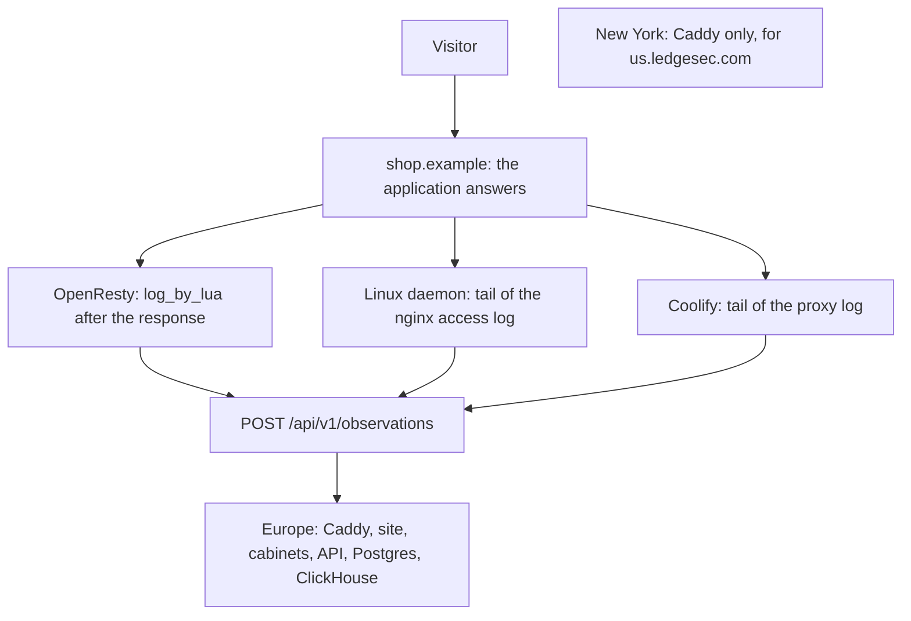

# Ledgesec

A journal of web server requests. The daemon reads the nginx access log or the Coolify proxy log and does not change the request. The cabinet shows the path, the status, the time, and the probe. An admin sees the visitor address. A site user sees the requests for their hosts, without addresses.

This is not a WAF. The request still reaches the application. The license is MIT.

One repository. The edge, the cabinet, and the API live here. The package for a customer's server is here too, in its own directory. The product number is the `VERSION` file: closed work raises the patch and gets a tag. A person sets minor and major by hand.

| Directory | What it is |
| --- | --- |
| `edge/` | Our edge, Caddy. First delivery: two servers, and port 443 only here. |
| `api/` | Sites, certificates, the snapshot, and reading the journal. It does not stand on the visitor's path. |
| `web/` | The site, the blog, and both cabinets. The site is paper. The cabinets use the Threatrix shell. |
| `packages/customer-gate/` | Lua on the customer's OpenResty. Without a pass it sends the browser to the edge. For a site that does not change its A record. It is not part of cabinet v1. |

Angie and Caddy will get their own packages when a customer needs them. They are not here yet.

## Layout

The visitor reaches the customer's server. The application answers as before. A collector only reads the log and posts a batch to `POST https://dash.ledgesec.com/api/v1/observations`. Europe keeps the journal. New York is a separate edge, with no databases and no cabinet.



New York does not stand on the customer's request path and does not store the journal.

## Connections

The cabinet shows the ingest secret and the host id on the host. The examples below use placeholders. One file: `/etc/ledgesec/agent.env`.

```
LEDGESEC_SITE_ID=host-from-the-cabinet
LEDGESEC_INGEST_SECRET=from-the-cabinet
LEDGESEC_INGEST_URL=https://dash.ledgesec.com/api/v1/observations
```

### OpenResty

`log_by_lua` writes the line after the response. The request is not changed. Plain nginx cannot load this file. That server uses the Linux daemon.

```nginx
env LEDGESEC_INGEST_SECRET;
env LEDGESEC_SITE_ID;

http {
    lua_package_path "/usr/local/ledgesec/lua/?.lua;;";
    lua_shared_dict ledgesec_observe 16m;

    init_worker_by_lua_block {
        require("ledgesec.observe").start()
    }

    server {
        listen 443 ssl;
        server_name shop.example;

        location / {
            log_by_lua_block {
                require("ledgesec.observe").note()
            }
            proxy_pass http://app:8080;
        }
    }
}
```

### Linux daemon

Nginx stays as it is. The format belongs in the `http` block, so every server on that machine is included. A `server` block that already has its own `access_log` repeats the `ledgesec` line. `ledgesec-agent` reads the file and posts the same batch.

```nginx
log_format ledgesec '$msec $remote_addr $host "$request" $status $request_time';
access_log /var/log/nginx/ledgesec.log ledgesec;
```

### Coolify

The same daemon on the Coolify server reads the whole proxy log, including a name that never reached an application. Add these lines to the same env file:

```
LEDGESEC_LOG=/data/coolify/proxy/access.log
LEDGESEC_EDGE_ID=eu
```

DNS and Apache are listed in the cabinet and cannot be added yet.

## Platform

The European machine runs one `docker-compose.yml`: Postgres, ClickHouse, the API, the site, and the edge. The database schema is built into those images. A separate bind-mount for SQL is not needed. Coolify in Russia deploys this file over SSH. The New York machine is not in this file.

In Coolify:

1. A Git resource, build pack Docker Compose, file `docker-compose.yml` at the root.
2. Advanced → Docker compose → Compose deployment: Raw (deploy file as-is). Otherwise the panel adds its own proxy.
3. On the European server the proxy is Custom (None). Do not set a domain on the resource. Only the `edge` service publishes 80 and 443. That is Caddy, not the panel proxy.
4. Set `POSTGRES_PASSWORD`, `CLICKHOUSE_PASSWORD`, and `LEDGESEC_SESSION_SECRET`. Do not put the admin in the variables: that row lives in Postgres. Do not set `EDGE_HTTP_PORT` or `EDGE_HTTPS_PORT` on the server: the edge takes 80 and 443.
5. DNS `dash` and `admin` are A records to the European address, the same one as `ledgesec.com`. Until they exist, the cabinet certificates will not be issued. Do not add the domain in Coolify.

Postgres and ClickHouse are not published on host ports. Locally, copy `.env.example` to `.env`.

The New York machine runs only `docker-compose.us.yml`, as its own resource. The databases, the site, and the dashboard are not included. On that machine:

```bash
docker compose -p ledgesec-us -f docker-compose.us.yml up --build -d
```

```bash
docker compose up --build
```

Check the customer package:

```bash
cargo test
```

Demo of the customer package, from the root:

```bash
cargo run -p ledgesec-gate
```
